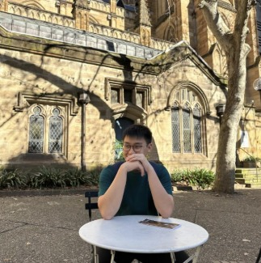
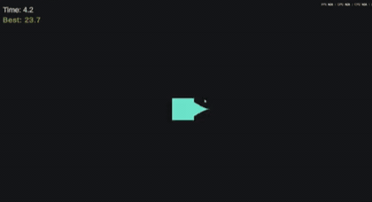
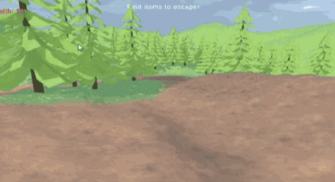
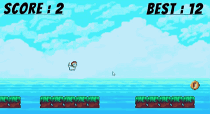

<table>
  <tr>
    <td width="250" valign="top">
      
    </td>
    <td valign="top">
      <h1>Oliver Tong</h1>
      <h3>🎮 Game Programmer</h3>
      
Hi, I'm Oliver! I'm a <b>Game Application &amp; Technology</b> student at <b>Bina Nusantara University</b>, passionate about game design and player experience.

      
With hands-on experience in <b>Unity</b>, I specialize in designing engaging <b>2D gameplay loops</b>, core mechanics, and interactive systems, and I'm actively expanding my skills into <b>3D game design</b>.

      
📧 <a href="mailto:olivertong10@gmail.com">olivertong10@gmail.com</a> &nbsp;·&nbsp; 🎮 <a href="https://oliverrr100.itch.io/">itch.io</a>

    </td>
  </tr>
</table>

---

## 🕹️ Featured Projects

<table>
  <tr>
    <td width="50%" valign="top">
      
      <h3>Shape Survivor</h3>
      
A single-player survival game where you try to last as long as you can against a growing horde of zombies that keep duplicating.

      
 

      
<a href="https://oliverrr100.itch.io/shape-survivor">▶ Play on itch.io</a> &nbsp;·&nbsp; <a href="https://github.com/Oliverr100/ShapeSurvival_Project">View code →</a>

    </td>
    <td width="50%" valign="top">
      
      <h3>Lone Hero</h3>
      
A fast-paced third-person stealth and action-shooter prototype built in Unity 6. Stranded in an isolated alien arena and vastly outnumbered, you balance tense line-of-sight stealth with high-stakes projectile combat to secure key items and find the exit.

      
 

      
<a href="https://oliverrr100.itch.io/tps-lone-hero">▶ Play on itch.io</a> &nbsp;·&nbsp; <a href="https://github.com/Oliverr100/3D-TPS_LoneHero">View code →</a>

    </td>
  </tr>
  <tr>
    <td width="50%" valign="top">
      
      <h3>Cat Runner</h3>
      
An addictive endless runner starring an adorable, hat-sporting cat. Keep running, stay on the platforms and chase the highest score, but the further you go, the faster the world moves.

      
 

      
<a href="https://oliverrr100.itch.io/cat-runner">▶ Play on itch.io</a> &nbsp;·&nbsp; <a href="https://github.com/Oliverr100/CatRunner">View code →</a>

    </td>
    <td width="50%" valign="top">
      
      <h3>Away From Peak 🚧 work in progress</h3>
      
A 3D physics-based multiplayer escape game built natively in Roblox Studio with Luau. Subverting traditional "ragebait" climbers, players must rush <em>down</em> a steep, crumbling Mount Krakatau to escape a fast-pursuing lethal lava wall.

      
 

    </td>
  </tr>
</table>

---

## 🛠️ Tech Stack

---

## 📫 Get in Touch

I'm always happy to talk about games, collaborations or opportunities.

📧 **Email:** [olivertong10@gmail.com](mailto:olivertong10@gmail.com)  
🎮 **itch.io:** [oliverrr100.itch.io](https://oliverrr100.itch.io/)
