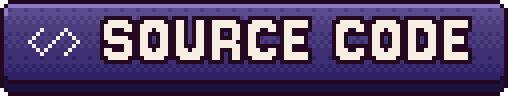
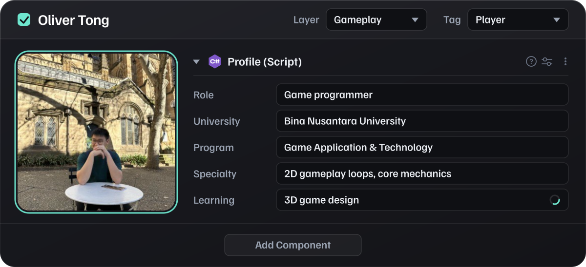
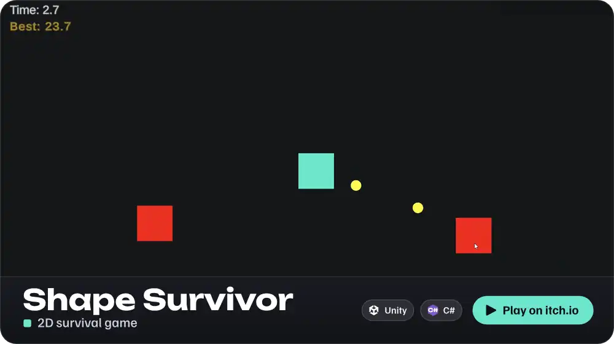
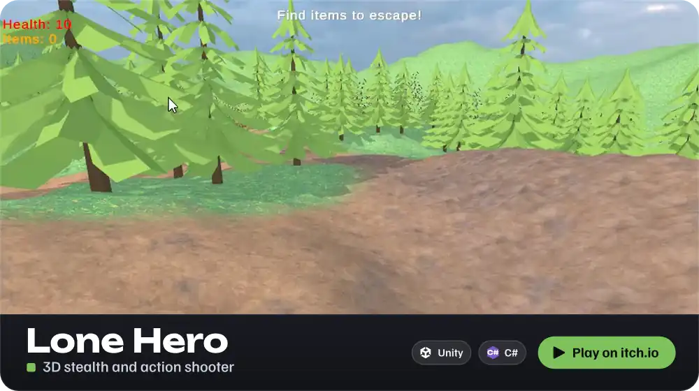
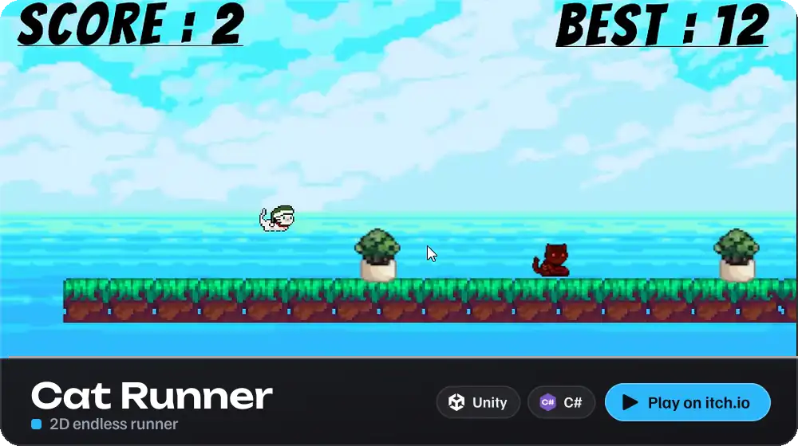
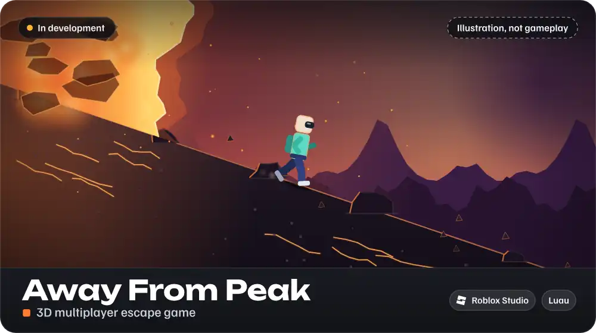
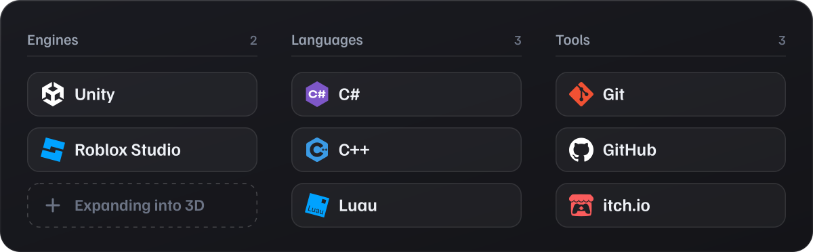

  

  
  
  

 

<h3></h3>

  

Hi, I'm Oliver! I'm a **Game Application & Technology** student at **Bina Nusantara University**, passionate about game design and player experience.

With hands-on experience in **Unity**, I specialize in designing engaging **2D gameplay loops**, core mechanics and interactive systems, and I'm actively expanding my skills into **3D game design**.

 

<h3></h3>

A single-player survival game where you try to last as long as you can against a growing horde of zombies that keep duplicating.

Play it on [itch.io](https://oliverrr100.itch.io/shape-survivor) or read the code on [GitHub](https://github.com/Oliverr100/ShapeSurvival_Project).

 

A fast-paced third-person stealth and action-shooter prototype built in Unity 6. Stranded in an isolated alien arena and vastly outnumbered, you balance tense line-of-sight stealth with high-stakes projectile combat to secure key items and find the exit.

Play it on [itch.io](https://oliverrr100.itch.io/tps-lone-hero) or read the code on [GitHub](https://github.com/Oliverr100/3D-TPS_LoneHero).

 

An addictive endless runner starring an adorable, hat-sporting cat. Keep running, stay on the platforms and chase the highest score, but the further you go, the faster the world moves.

Play it on [itch.io](https://oliverrr100.itch.io/cat-runner) or read the code on [GitHub](https://github.com/Oliverr100/CatRunner).

 

A 3D physics-based multiplayer escape game built natively in Roblox Studio with Luau. Subverting traditional "ragebait" climbers, players must rush *down* a steep, crumbling Mount Krakatau to escape a fast-pursuing lethal lava wall.

*In development. The animation above is an illustration of the idea, drawn for this page. It is not gameplay footage.*

 

<h3></h3>

  

 

  

  
  
  

  <a href="mailto:olivertong10@gmail.com">olivertong10@gmail.com</a>

